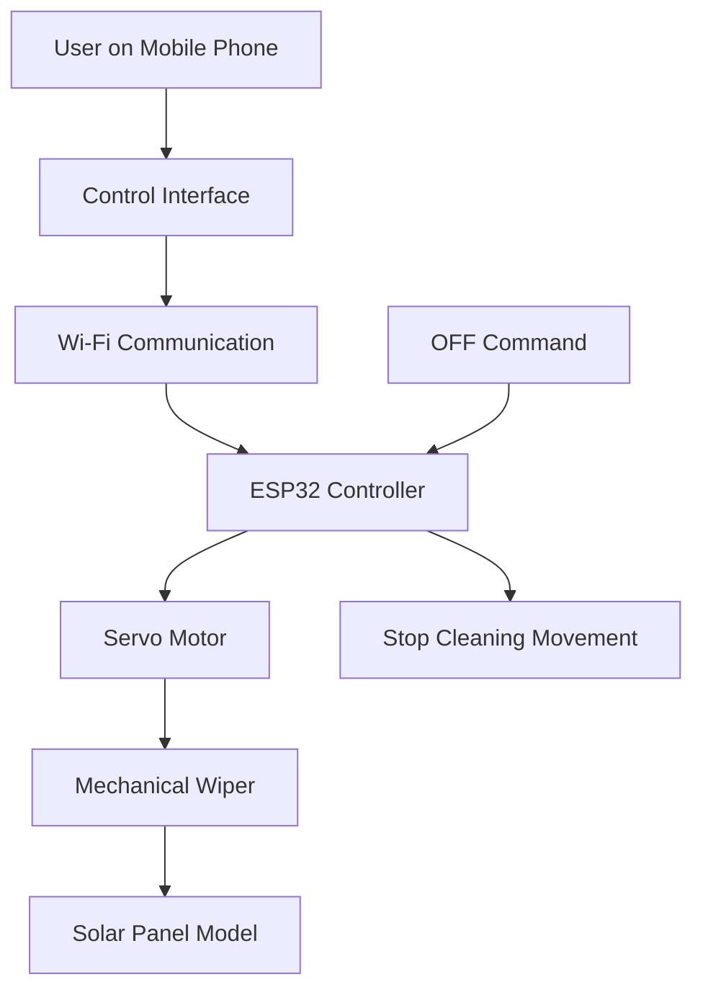

# Solar Panel Auto-Cleaning & Efficiency Monitoring System

An ESP32-based embedded systems and IoT project that enables remote control of a solar panel cleaning wiper using a mobile phone over Wi-Fi.

> **Project status:** Remote-controlled cleaning prototype. Dust sensing, electrical output monitoring, efficiency calculations, and automatic dust-triggered cleaning are planned enhancements, not implemented features.

## Table of Contents

- [Introduction](#introduction)
- [Project Overview](#project-overview)
- [Problem Statement](#problem-statement)
- [Objectives](#objectives)
- [Features](#features)
- [Hardware Requirements](#hardware-requirements)
- [Software Requirements](#software-requirements)
- [System Architecture](#system-architecture)
- [Circuit Connections](#circuit-connections)
- [Project Structure](#project-structure)
- [Installation and Setup](#installation-and-setup)
- [Uploading the Program](#uploading-the-program-to-the-esp32)
- [Operating the Cleaning Mechanism](#operating-the-cleaning-mechanism)
- [How ON/OFF Control Works](#how-onoff-control-works)
- [Prototype and Screenshots](#prototype-and-screenshots)
- [Testing and Results](#testing-and-results)
- [Limitations](#limitations)
- [Future Enhancements](#future-enhancements)
- [Troubleshooting](#troubleshooting)
- [Team Members](#team-members)
- [Academic Information](#academic-information)
- [References](#references)
- [License](#license)

## 1. Introduction

Solar panels convert sunlight into electrical energy and are widely used in renewable energy systems. However, dust, dirt, and other particles can accumulate on the panel surface and interfere with the sunlight reaching the photovoltaic cells.

Traditional solar panel cleaning often requires manual effort and physical access to the installation. Cleaning panels located on rooftops can be inconvenient and potentially unsafe.

The **Solar Panel Auto-Cleaning & Efficiency Monitoring System** is an embedded systems project designed to reduce this manual effort. It uses an ESP32 microcontroller, a servo motor, and a mechanical wiper to demonstrate remote-controlled cleaning of a solar panel model.

The user sends an ON or OFF command from a phone over Wi-Fi. The ESP32 processes the command and controls the servo motor, which moves the cleaning mechanism.

Although efficiency monitoring is part of the project title, the current prototype focuses on remote cleaning control. Electrical output monitoring and efficiency calculations are planned for future development.

## 2. Project Overview

| Attribute | Details |
|---|---|
| Project name | Solar Panel Auto-Cleaning & Efficiency Monitoring System |
| Project domain | Embedded Systems and IoT |
| Controller | ESP32 |
| Actuator | Servo motor |
| Programming language | Arduino C/C++ |
| Development environment | Arduino IDE |
| Communication | Wi-Fi |
| User interface | Phone-based remote control |
| Cleaning mechanism | Servo-driven wiper |
| Current implementation | Remote ON/OFF cleaning control |
| Monitoring capability | Not implemented in the current prototype |
| Database or cloud platform | Not specified; not required by the documented prototype |

### How it works

1. The user opens the available control interface on a phone.
2. The user sends a cleaning ON or OFF command.
3. The ESP32 receives the command over Wi-Fi.
4. The ESP32 controls the servo motor.
5. The servo moves the attached wiper across the solar panel model.
6. The user can stop the cleaning mechanism remotely.

The prototype demonstrates the control and mechanical movement of a cleaning system. It does not establish a measured improvement in solar panel efficiency.

## 3. Problem Statement

Solar panels require periodic cleaning to remove accumulated dust and dirt. Manual cleaning creates several challenges:

- Physical effort is required to reach and clean the panels.
- Rooftop installations can be difficult and unsafe to access.
- Repeated cleaning requires time and maintenance effort.
- Water-based or manual cleaning may be inconvenient for some installations.
- More sophisticated automatic cleaning systems may be too costly or complex for small setups.

This project addresses these problems by demonstrating a low-cost, servo-based cleaning mechanism controlled remotely through an ESP32.

## 4. Objectives

The primary objectives are:

- Develop a low-cost solar panel cleaning prototype.
- Use an ESP32 to control the cleaning mechanism.
- Operate a servo-driven wiper remotely.
- Provide ON/OFF control through a phone over Wi-Fi.
- Reduce the need for direct physical access to the panel.
- Establish a foundation for future dust detection and electrical performance monitoring.

## 5. Features

### 5.1 Implemented features

- **ESP32-based control:** The ESP32 acts as the main controller.
- **Servo motor actuation:** A servo motor drives the cleaning mechanism.
- **Remote ON/OFF operation:** A phone can send commands to control cleaning.
- **Wi-Fi communication:** Commands are communicated wirelessly.
- **Mechanical wiping:** The wiper moves over the solar panel model.
- **Remote stopping:** The user can stop the mechanism by sending an OFF command.
- **Low-cost prototype:** The design uses a simple controller, actuator, and mechanical assembly.

### 5.2 Planned features

The following features are described as future enhancements and must not be considered implemented in the current prototype.

- Dust accumulation detection.
- Voltage and current measurement.
- Real-time power monitoring.
- Solar panel efficiency calculations.
- Automatic cleaning based on a dust threshold.
- Scheduled cleaning.
- Rain and weather sensing.
- Cloud-based monitoring.
- Mobile application with monitoring and alerts.
- Multiple-panel monitoring.
- AI/ML-based prediction of cleaning requirements.

## 6. Hardware Requirements

| Component | Purpose |
|---|---|
| ESP32 development board | Processes remote commands and controls the servo motor |
| Servo motor | Produces the movement required to operate the wiper |
| Solar panel or solar panel model | Surface on which the cleaning mechanism operates |
| Wiper or cleaning mechanism | Moves across the panel surface to remove dust |
| Connecting wires | Connect the electronic components |
| Suitable power supply | Supplies power to the ESP32 and servo motor |
| Laptop or computer | Used to develop and upload the Arduino program |
| Mobile phone | Used to send remote ON/OFF commands |

**Important:** The exact ESP32 board variant, servo model, power supply rating, wiring arrangement, and other component specifications must be verified from the physical prototype.

A real solar panel is not necessarily required to demonstrate the basic control logic if the prototype uses a model panel.

## 7. Software Requirements

| Software or tool | Purpose |
|---|---|
| Arduino IDE | Editing, compiling, and uploading the program |
| ESP32 board package | Enables ESP32 development in Arduino IDE |
| Arduino C/C++ | Implements the controller logic |
| Compatible USB cable | Connects the ESP32 to the computer for uploading |
| Phone web browser or control interface | Sends the remote commands, according to the implemented interface |

The precise ESP32 board package version, additional Arduino libraries, and browser interface implementation must be confirmed from the actual source code.

No separate cloud service, database, or native mobile application is established as a requirement for the documented prototype.

## 8. System Architecture

The system follows a simple command-and-control architecture.



### 8.1 Architecture components

**User interface:** The phone is used to issue ON and OFF commands.

**Communication module:** The ESP32's built-in Wi-Fi provides wireless communication.

**Processing module:** The ESP32 interprets the received command and determines the servo's response.

**Actuation module:** The servo motor produces the required mechanical movement.

**Cleaning module:** The attached wiper travels over the solar panel model.

### 8.2 Data flow

The principal data flow is:

`Phone → Wi-Fi → ESP32 → Servo Motor → Wiper → Solar Panel`

The OFF command is sent through the same control path to stop cleaning movement.

## 9. Circuit Connections

The project report confirms that the servo motor is connected to the ESP32 using connecting wires and that an appropriate power supply is required. However, it does not specify the exact GPIO assignment or electrical wiring details.

The following table distinguishes the documented connections from details that still require verification.

| Connection | Purpose | Verification status |
|---|---|---|
| ESP32 power | Powers the controller | Exact supply arrangement not specified |
| Servo power | Powers the actuator | Voltage and current rating not specified |
| Servo control signal | Allows the ESP32 to command servo movement | GPIO pin not verified |
| Common ground | Provides a shared electrical reference when required by the power arrangement | Exact wiring not verified |
| Servo-to-wiper mechanical attachment | Transfers servo movement to the wiper | Exact mounting arrangement not specified |

### Electrical safety

- Verify the servo's rated operating voltage and current before connecting it.
- Do not assume an ESP32 GPIO pin can supply the servo's motor current.
- Use a suitable regulated servo power source if required by the servo's specifications.
- Ensure the ESP32 and servo share a common ground when using a separate servo supply.
- Check wiring and mechanical travel before operating the mechanism continuously.
- Disconnect power before changing the wiring.

**Before publishing a verified pinout:** Inspect `sketch_oct3a.ino` for the servo pin definition and confirm it against the physical wiring. The source code alone cannot establish that the physical circuit matches the configured pin.

## 10. Project Directory Structure

A recommended repository structure for this project is:

```text
solar-panel-auto-cleaning/
├── sketch_oct3a.ino
├── README.md
├── Capstone_Report_Solar_Panel_Auto_Cleaning.pdf
├── images/
│   ├── prototype.jpg
│   └── control-interface.png
├── .gitignore
└── LICENSE
```

### File descriptions

| File or directory | Purpose |
|---|---|
| `sketch_oct3a.ino` | Arduino source code for the ESP32 |
| `README.md` | Project overview, setup guide, and documentation |
| `Capstone_Report_Solar_Panel_Auto_Cleaning.pdf` | Academic capstone report |
| `images/` | Project photographs and genuine screenshots |
| `.gitignore` | Prevents unnecessary generated or local files from being committed |
| `LICENSE` | Optional license file, if the team chooses to publish one |

This is a recommended organization, not a claim that every file already exists in the repository. Keep the actual filenames consistent with the files you upload to GitHub.

## 11. Installation and Setup

### 11.1 Install Arduino IDE

1. Download Arduino IDE from the official website: https://www.arduino.cc/en/software
2. Install the version compatible with your operating system.
3. Open Arduino IDE.
4. Connect the ESP32 to the computer using a suitable USB data cable.

### 11.2 Install ESP32 board support

1. Open Arduino IDE.
2. Navigate to **File → Preferences**.
3. Find the field for additional board manager URLs.
4. Add the official Espressif Arduino-ESP32 package index if it is not already configured:

   `https://espressif.github.io/arduino-esp32/package_esp32_index.json`

5. Open **Tools → Board → Boards Manager**.
6. Search for `esp32`.
7. Install the ESP32 platform published by Espressif Systems.
8. Wait for the installation to finish.

For additional information, see the official [Arduino-ESP32 documentation](https://docs.espressif.com/projects/arduino-esp32/en/latest/).

### 11.3 Open the project

1. Download or clone the project repository from GitHub.
2. Locate `sketch_oct3a.ino`.
3. Open it in Arduino IDE.
4. Review the code for required libraries and configuration settings.
5. Install any required libraries using Arduino IDE's Library Manager or the library's official installation instructions.

**Important:** Do not enter guessed Wi-Fi credentials or change GPIO assignments based on this README. Use the actual source code and your own network configuration.

### 11.4 Configure Wi-Fi

Before uploading, inspect the source code to determine how the ESP32 obtains its network connection.

Depending on the implementation, the ESP32 might connect to an existing Wi-Fi network or create its own access point. The actual operating mode must be confirmed from `sketch_oct3a.ino`.

If the code contains Wi-Fi credentials:

- Replace example or placeholder values with your own configuration.
- Never commit real passwords or private credentials to a public repository.
- Remove any exposed credentials from the published source before uploading it to GitHub.
- If necessary, use a separate local configuration file excluded by `.gitignore`.

The exact SSID, password configuration, network mode, and connection behavior are not specified in this README because they have not been verified from the source.

## 12. Uploading the Program to the ESP32

1. Open `sketch_oct3a.ino` in Arduino IDE.
2. Connect the ESP32 using a USB data cable.
3. Select the appropriate ESP32 board under **Tools → Board**.
4. Select the corresponding serial port under **Tools → Port**.
5. Check that the required libraries are installed.
6. Click **Verify** to compile the sketch.
7. Resolve any compilation errors before proceeding.
8. Click **Upload** to transfer the compiled program to the ESP32.
9. Wait until Arduino IDE reports that the upload has completed successfully.
10. If the upload fails, check the cable, board selection, port selection, and any board-specific boot-mode requirements.
11. After uploading, restart or reset the ESP32 if required.
12. Open Serial Monitor if the program prints connection status or other debugging information.

The exact board model and serial port will depend on the hardware connected to your computer.

## 13. Operating the Cleaning Mechanism

Once the firmware is uploaded and the hardware is connected correctly, follow the workflow below.

### Step 1: Power the prototype

Power the ESP32 and servo using the verified power arrangement. Ensure the wiper can move freely without hitting the frame or other components.

### Step 2: Establish Wi-Fi communication

Allow the ESP32 to initialize its configured Wi-Fi mode.

If it connects to a router, use the appropriate network. If it creates an access point, connect the phone to that access point instead.

The actual network mode must be checked in the source code.

### Step 3: Open the control interface

Use the control interface implemented by the project. If the firmware provides an HTTP web server, follow the actual server address and route definitions in the sketch.

Do not assume that a particular IP address, webpage, or URL path exists until it has been verified.

### Step 4: Send the ON command

Select the implemented ON control.

The ESP32 should receive the command and activate the servo movement associated with cleaning.

### Step 5: Observe the wiper

Check that the servo moves the wiper across the solar panel model without obstruction.

### Step 6: Send the OFF command

Select the implemented OFF control.

The servo-driven cleaning movement should stop according to the firmware's implemented behavior.

### Step 7: Verify the result

Repeat the ON/OFF test and confirm that the control interface, ESP32, servo, and wiper respond as expected.

**Important:** The exact control labels, URL routes, and stopping position depend on the implementation in `sketch_oct3a.ino`. Consult the source before following any route-specific instructions.

## 14. How ON/OFF Control Works

### ON command

When the user sends the ON command:

1. The control interface sends the command over Wi-Fi.
2. The ESP32 receives the request or message.
3. The firmware identifies it as a request to start cleaning.
4. The ESP32 commands the servo motor.
5. The servo moves the wiper across the panel.

### OFF command

When the user sends the OFF command:

1. The control interface sends the stop command.
2. The ESP32 receives and processes it.
3. The firmware changes the servo control behavior.
4. The cleaning movement stops.

The precise implementation matters. For example, stopping could involve holding the servo at a position, detaching the servo signal, or terminating a repeated movement loop. These behaviors are not interchangeable, and the actual implementation must be verified from the sketch.

The ON/OFF commands control the cleaning mechanism; they do not measure dust or calculate panel efficiency.

## 15. Prototype and Screenshots

### 15.1 Final prototype

Place the actual prototype photograph in the repository at `images/prototype.jpg`.

Once the photograph has been added, use the following Markdown:

```markdown

```

The photograph should show the ESP32, servo motor, cleaning mechanism, and solar panel model as clearly as possible.

### 15.2 Control interface

If the project has a genuine phone or browser control interface, capture a screenshot and save it as `images/control-interface.png`.

```markdown

```

Only include this image if the screenshot exists and accurately represents the implemented interface. Do not create a screenshot that suggests unsupported monitoring or automation features.

### 15.3 Suggested additional photographs

For a clearer project presentation, consider adding genuine photographs of:

- The ESP32 and wiring arrangement.
- The servo motor and mechanical wiper.
- The prototype during cleaning.
- The ON command and observed servo response.
- The OFF command and stopped cleaning mechanism.

Use relative image paths so the images display correctly on GitHub.

## 16. Testing and Results

The capstone report records the following functional test results for the prototype.

| Test case | Expected result | Reported status |
|---|---|---|
| ESP32 operation | ESP32 operates correctly | Pass |
| Remote ON command | Servo starts cleaning movement | Pass |
| Remote OFF command | Servo stops cleaning movement | Pass |
| Servo response | Servo responds to ESP32 commands | Pass |
| Cleaning mechanism | Wiper moves across the panel | Pass |

These statuses are reported in the supplied academic report; they should not be interpreted as independent test results reproduced during preparation of this README.

### Observed outcome

The report describes a working prototype in which the ESP32 receives remote ON/OFF commands and controls the servo-driven wiper. This demonstrates the feasibility of remote cleaning control without requiring the user to physically reach the panel.

### Efficiency measurement

No measured improvement in solar panel efficiency is claimed.

The current prototype does not include the dust sensor, voltage/current monitoring, or efficiency calculations required to quantify the effect of cleaning on electrical output.

To evaluate efficiency improvement in a future version, the team would need to collect comparable electrical measurements under controlled or appropriately documented conditions before and after cleaning.

## 17. Limitations

The current prototype has the following limitations:

1. **No dust detection:** The system does not automatically determine when a panel needs cleaning.
2. **No electrical output monitoring:** Voltage, current, and power are not measured by the documented prototype.
3. **No efficiency calculation:** The system does not calculate or display changes in solar panel efficiency.
4. **No automatic dust-triggered cleaning:** Cleaning depends on user-issued commands.
5. **No documented scheduling feature:** Timed or RTC-based cleaning is not part of the reported implementation.
6. **Prototype-scale mechanism:** The demonstrated design uses a simple wiper and solar panel model.
7. **Hardware details require confirmation:** Exact wiring, GPIO assignments, servo angles, and power ratings are not specified in the report.
8. **Network dependence:** Remote control requires a working communication path between the phone and ESP32.
9. **No verified cloud monitoring:** A cloud dashboard and remote monitoring service are not established features of the current system.

## 18. Future Enhancements

The following improvements could extend the prototype into a more intelligent solar panel maintenance system.

| Enhancement | Purpose |
|---|---|
| Dust sensor | Detect dust accumulation on the panel |
| Voltage/current sensor, such as INA219 | Measure electrical operating parameters where suitable |
| Power monitoring | Calculate electrical power from voltage and current measurements |
| Efficiency analysis | Compare appropriate performance measurements before and after cleaning |
| Automatic dust-triggered cleaning | Start cleaning when a configured dust threshold is reached |
| RTC-based scheduling | Allow cleaning at configured times |
| Rain or weather sensor | Incorporate environmental conditions into cleaning decisions |
| Cloud dashboard | Provide remote access to collected monitoring data |
| Mobile application | Add a dedicated control, status, and alert interface |
| Multiple-panel support | Extend control and monitoring to additional panels |
| AI/ML prediction | Estimate cleaning requirements using collected data |

These are possible future developments, not existing features.

Any implementation of automatic cleaning should also account for mechanical limits, obstruction detection, electrical safety, and safe behavior during communication loss.

## 19. Troubleshooting

### 19.1 ESP32 is not detected

**Possible causes**
- USB cable supports charging but not data.
- Incorrect or missing USB-to-serial driver.
- The selected port is incorrect.
- The board is not receiving power.

**Solutions**
1. Try a known working USB data cable.
2. Check whether the board's power indicator turns on.
3. Check the available ports in Arduino IDE.
4. Install the appropriate driver if required by the board.
5. Reconnect the board and select the correct port.

### 19.2 Program upload fails

**Possible causes**
- Incorrect board or port selection.
- USB connection problems.
- Board-specific boot-mode issues.
- Compilation errors or missing libraries.

**Solutions**
1. Confirm that the sketch compiles successfully.
2. Select the correct ESP32 board.
3. Check the serial port.
4. Close other programs that may be using the port.
5. Try another USB cable or port.
6. Follow the board manufacturer's upload procedure if manual boot mode is necessary.

### 19.3 ESP32 does not connect to Wi-Fi

**Possible causes**
- Incorrect network credentials.
- Unsupported network configuration.
- Weak signal.
- Incorrect Wi-Fi operating mode.
- Network settings that differ from those expected by the firmware.

**Solutions**
1. Inspect the Wi-Fi configuration in the sketch.
2. Verify the configured SSID and credentials locally.
3. Confirm whether the ESP32 connects to a router or creates an access point.
4. Check any connection messages printed to Serial Monitor.
5. Confirm that the phone is connected to the correct network.

Do not publish private Wi-Fi credentials while debugging the project.

### 19.4 Phone cannot control the mechanism

**Possible causes**
- The phone cannot reach the ESP32.
- The control interface uses an incorrect address or route.
- The firmware is not running correctly.
- The phone and ESP32 do not have a working network path.

**Solutions**
1. Confirm that the ESP32 has initialized successfully.
2. Inspect the server and route definitions in the sketch, if a web server is used.
3. Verify the actual address or interface provided by the firmware.
4. Check that the command names and request format match the implementation.
5. Test whether the phone and ESP32 can communicate over the configured network.

### 19.5 Servo motor does not move

**Possible causes**
- Incorrect control-pin wiring.
- Insufficient servo power.
- Incorrect signal configuration.
- Mechanical obstruction.
- Incompatible servo control code or library.

**Solutions**
1. Check the servo model and its rated voltage.
2. Verify the signal pin against the actual sketch and circuit.
3. Inspect the wiring and ground connection.
4. Confirm that the firmware is issuing the expected servo command.
5. Test the mechanism without mechanical load, where safe.
6. Check for obstructions before repeating the test.

### 19.6 Servo moves but does not clean the panel

**Possible causes**
- Incorrect mechanical alignment.
- Loose attachment between the servo and wiper.
- Insufficient movement range.
- Excessive friction or mechanical load.

**Solutions**
1. Secure the wiper attachment.
2. Check that the mechanism can travel freely.
3. Verify the actual programmed servo movement range.
4. Adjust the mechanical arrangement carefully without exceeding the servo's safe travel.

### 19.7 Servo does not stop as expected

**Possible causes**
- The OFF request is not being received.
- The firmware does not process the stop command correctly.
- The current movement routine does not check for new commands.
- The servo is commanded to hold a position rather than stop producing torque.

**Solutions**
1. Verify that the OFF request reaches the ESP32.
2. Inspect the command-handling and servo-control logic.
3. Confirm the intended stopping behavior in the code.
4. Disconnect power if the mechanism behaves unsafely.

## 20. Team Members

The following team details are taken from the supplied capstone report.

| S. No. | Team member | Registration number |
|---:|---|---|
| 1 | Barathkumar S (Team Leader) | 611224104019 |
| 2 | Dharanidharan B | 611224104034 |
| 3 | Boobalan L | 611224104023 |
| 4 | Babu C P | 611224104017 |
| 5 | Arunbalaji S S | 611224104013 |
| 6 | Divyaprasath K R | 611224104047 |

## 21. Academic Information

| Attribute | Details |
|---|---|
| Project title | Solar Panel Auto-Cleaning & Efficiency Monitoring System |
| Project type | Capstone project |
| Degree | Bachelor of Engineering |
| Department | Computer Science and Engineering |
| Institution | Knowledge Institute of Technology, Salem |
| University affiliation | Anna University, Chennai |
| Faculty in-charge | Mr. S. Sabarinathan, Assistant Professor, Department of Electronics and Communication Engineering |
| Head of Department identified in the report | Mr. T. Karthikeyan |
| Report date | October 2026 |

The project was developed to demonstrate an embedded control solution for remote solar panel cleaning and to provide a foundation for future monitoring and automation.

## 22. References

The following references are listed in the supplied capstone report.

1. A. B. Y. Zaki and M. F. L. Abdullah, “Self-Sustaining Solar Panel Cleaning Solution with Integrated IoT Monitoring,” *Journal of Electronics and Voltage Applications*, vol. 6, no. 2, pp. 85–94, 2025.

2. K. C. Mane et al., “Automatic Cleaning and Maintenance of Solar Panel and Efficiency Monitoring,” in *Proceedings of the 2nd International Conference on Edge Computing and Applications (ICECAA)*, Namakkal, India, 2023, pp. 1582–1586.

3. P. A. Patil, J. S. Bagi, and M. M. Wagh, “A review on cleaning mechanism of solar photovoltaic panel,” in *Proceedings of ICECDS*, Chennai, India, 2017, pp. 250–256.

4. H. Abuzaid, M. Awad, and A. Shamayleh, “Impact of dust accumulation on photovoltaic panels: a review paper,” *International Journal of Sustainable Engineering*, vol. 15, no. 1, pp. 264–285, 2022.

5. S. A. Sulaiman, M. N. H. Mat, F. M. Guangul, and M. A. Bou-Rabee, “Real-time study on the effect of dust accumulation on performance of solar PV panels in Malaysia,” in *Proceedings of ICEIT*, 2015.

### Technical documentation

- Arduino IDE: https://www.arduino.cc/en/software
- Arduino-ESP32 documentation: https://docs.espressif.com/projects/arduino-esp32/en/latest/
- Arduino language reference: https://docs.arduino.cc/language-reference/

## 23. Acknowledgements

The team acknowledges Knowledge Institute of Technology, Salem, and the faculty members who supported the academic capstone project.

The team also acknowledges the researchers and technical authors whose work on solar panel cleaning, dust accumulation, and photovoltaic performance informed the project background and future scope.

## 24. License

No license is specified in the supplied project report.

If the team wants to allow others to reuse, modify, and distribute the source code under clearly defined terms, the **MIT License** is one possible option. Before adding it, ensure that all team members agree to the licensing decision and that the team has the right to license all included material.

If the MIT License is selected, add a `LICENSE` file containing the official license text and the appropriate copyright holder and year. Until this is done, do not describe the project as MIT-licensed.

---

## Conclusion

The Solar Panel Auto-Cleaning & Efficiency Monitoring System demonstrates remote control of a servo-driven solar panel cleaning mechanism using an ESP32 and Wi-Fi. Its primary contribution is reducing the need for direct physical access during cleaning by allowing the user to start and stop the mechanism remotely.

The current prototype is a foundation for future development. Adding dust sensing, electrical measurements, efficiency analysis, and automatic cleaning logic could extend it into a more comprehensive solar panel maintenance system.

**Current achievement:** Remote-controlled cleaning prototype demonstrated.

**Future goal:** Intelligent, sensor-assisted solar panel cleaning and performance monitoring.
